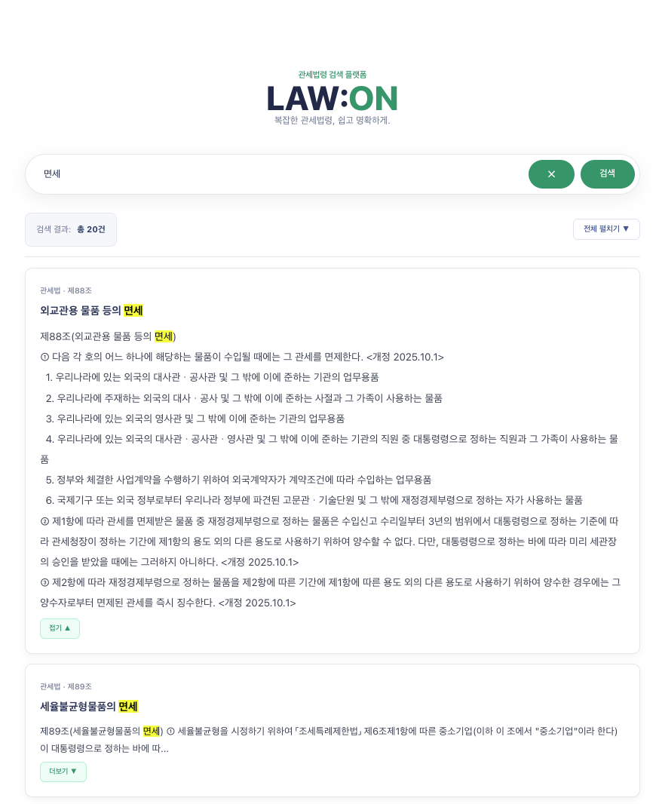

# LAW:ON ⚖️

> **복잡한 관세법령을 더 쉽고 명확하게 찾을 수 있도록.**  
> Spring Boot와 React로 구현한 관세법령 검색 서비스이자, 향후 AI 기반 법령 질의응답(RAG)으로 확장할 개인 포트폴리오 프로젝트입니다.


## 🖥️ 서비스 화면

### 메인 화면

관세법령을 키워드로 검색할 수 있는 메인 화면입니다.


### 법령 검색 결과

검색어에 해당하는 조문을 제목 우선으로 정렬하고,
검색어 하이라이트 및 조문 펼치기 기능을 제공합니다.




## 프로젝트 소개

LAW:ON은 국가법령정보센터의 법령 데이터를 수집하여 PostgreSQL에 저장하고, 사용자가 관세 관련 법령 및 조문을 검색할 수 있도록 만든 웹 애플리케이션입니다.

기존 공공기관 웹 서비스 운영·개발 경험을 기반으로, **Spring Boot · JPA · React · TypeScript** 환경에서 데이터 수집부터 검색 API, 화면 구현까지 전체 흐름을 직접 학습하고 구현하는 것을 목표로 합니다.

**현재 상태:** 관세법령 데이터 수집 및 키워드 검색 기능 구현 완료. AI/RAG 질의응답은 개발 예정입니다.

## 주요 기능

### 1. 관세법령 데이터 수집 및 저장

- 국가법령정보센터 API를 통한 법령 JSON 조회
- 법령(`Law`), 법령 버전(`LawVersion`), 조문(`LawArticle`) 데이터 분리 저장
- 항·호·목 등 중첩된 조문 구조 파싱
- 법령 버전 번호(MST)를 이용한 중복 저장 방지
- Spring 트랜잭션을 활용한 데이터 저장 처리

개발 환경에서 수집하여 확인한 데이터는 아래와 같습니다.

| 법령 | 조문 수 |
| --- | ---: |
| 관세법 | 424 |
| 관세법 시행령 | 439 |
| 관세법 시행규칙 | 144 |
| **합계** | **1,007** |

> 위 수치는 개발 당시 로컬 DB의 적재 결과입니다. DB 데이터 자체는 Git 저장소에 포함되지 않습니다.

### 2. 법령 통합 검색

- 조문 제목과 본문에 대한 키워드 검색
- 제목 일치 결과 우선 정렬
- 관세법 → 관세법 시행령 → 관세법 시행규칙 순의 법령 위계 정렬
- 서버 측 페이지네이션 및 전체 검색 건수 표시
- 검색어 하이라이트 및 조문 펼치기/접기

현재 검색은 **연속된 문자열을 기준으로 하는 키워드 검색**입니다. 예를 들어 `보세판매장 수수료`처럼 단어 사이에 다른 문구가 포함된 검색은 개선 예정입니다.

### 3. 법령 본문 및 이미지 표시

- 법령명과 조문 번호 표시
- 긴 조문 미리보기 및 전체 펼치기
- 조문 내 HTML 공백 문자 정리
- 법령에 포함된 표·계산식 이미지를 원문 위치에 표시
- 이미지 영역과 텍스트를 분리하면서 검색어 강조 기능 유지

> 외부 법령 데이터의 이미지 형식은 다양할 수 있으므로, 현재 확인된 형식 외의 사례는 추가 검증이 필요합니다.

## 기술 스택

| 구분 | 기술 |
| --- | --- |
| Backend | Java 21, Spring Boot 4, Spring Data JPA, Hibernate, Maven |
| Frontend | React, TypeScript, Vite, CSS |
| Database | PostgreSQL |
| API 연동 | 국가법령정보센터 API, Spring RestClient |
| 협업·형상관리 | Git, GitHub (Feature Branch, Pull Request) |

## 시스템 구성

```text
국가법령정보센터 API
        │ JSON
        ▼
   Spring Boot
   ├─ LawApiClient
   ├─ LawImportService
   ├─ LawArticleService
   └─ LawArticleRepository (JPA)
        │
        ▼
    PostgreSQL
   ├─ law
   ├─ law_version
   └─ law_article
        ▲
        │ 검색 API
        ▼
 React + TypeScript
   ├─ App.tsx
   ├─ ArticleCard.tsx
   ├─ ArticleContent.tsx
   └─ HighlightedText.tsx
```

## API 예시

### 조문 통합 검색

```http
GET /api/laws/articles/search?keyword=면세&page=0&size=10
```

- `keyword`: 검색 키워드
- `page`: 페이지 번호 (0부터 시작)
- `size`: 페이지당 결과 수

검색 결과는 페이지 정보와 조문 목록을 포함합니다. 프론트엔드는 검색 결과의 `content`, `totalElements`, `totalPages` 등을 활용합니다.

## 실행 환경

### 사전 준비

- JDK 21
- PostgreSQL
- Node.js 및 npm
- 국가법령정보센터 API 이용을 위한 인증 정보

### Backend

```bash
cd backend
./mvnw spring-boot:run
```

> Maven Wrapper(`mvnw`)가 없는 환경에서는 설치된 Maven으로 `mvn spring-boot:run`을 사용합니다.

`application.properties`에서 DB 연결 설정을 확인하고, 법령 API 인증 정보는 환경 변수 `LAW_API_OC`로 설정합니다. **API 인증 정보와 DB 비밀번호는 Git에 커밋하지 않습니다.**

DB 스키마와 법령 데이터의 최초 구성은 현재 개발 환경에 맞춰 수행해야 하며, 이를 자동화하는 작업은 향후 개선 대상입니다.

### Frontend

```bash
cd frontend
npm install
npm run dev
```

백엔드 서버와 PostgreSQL을 먼저 준비한 뒤 프론트엔드를 실행합니다. API 주소 및 포트는 실제 프로젝트 설정에 맞춰 확인해야 합니다.

## 개발 과정에서 해결한 문제

### 법령별 JSON 구조 차이

국가법령정보센터 API가 제공하는 조문 데이터는 항·호·목 구조가 항상 동일하지 않았습니다. 배열과 객체 형태를 구분해 처리하도록 파싱 로직을 개선하여 실제 법령 데이터를 저장할 수 있게 했습니다.

### 검색 결과 정렬과 페이지네이션

사용자가 찾는 조문을 더 쉽게 확인할 수 있도록 조문 제목 일치를 우선하고, 그다음 법령 위계와 조문 번호를 고려하도록 JPQL 검색 쿼리를 구성했습니다. 검색 결과에 페이지네이션을 적용해 화면에서 필요한 범위만 조회하도록 구현했습니다.

### 표·계산식 이미지의 원문 노출

법령 데이터에 포함된 `` 태그와 표 텍스트가 화면에 그대로 노출되는 문제를 발견했습니다. 이미지 영역을 별도로 처리하는 `ArticleContent` 컴포넌트를 만들어 텍스트와 이미지를 원래 순서대로 표시하도록 개선했습니다.

## 향후 개발 계획

- [ ] 복수 검색어 처리 및 검색 정확도 개선
- [ ] 법령 버전 관리 및 현행 법령 필터링
- [ ] RAG 기반 자연어 법령 질의응답
- [ ] AI 답변의 근거 법령·조문 표시 및 검증
- [ ] DB 초기화·마이그레이션 자동화
- [ ] 테스트 보강 및 실행 환경 재현성 개선
- [ ] 서비스 시연 화면 또는 영상 추가

## 프로젝트 목적

LAW:ON은 단순한 기능 구현에 그치지 않고, **외부 API 데이터 수집 → 구조화 → DB 저장 → 검색 API → 사용자 화면**으로 이어지는 전체 서비스 개발 흐름을 직접 경험하고 설명할 수 있는 포트폴리오를 목표로 합니다.

향후에는 검색된 법령을 근거로 답변하는 RAG 기능을 도입해, 법령 원문 검색과 AI 기반 설명을 함께 제공하는 서비스로 확장할 계획입니다.

---

*본 프로젝트는 학습 및 취업 포트폴리오 목적으로 개발 중이며, 공식 법령 해석이나 관세 행정 서비스를 대체하지 않습니다.*
